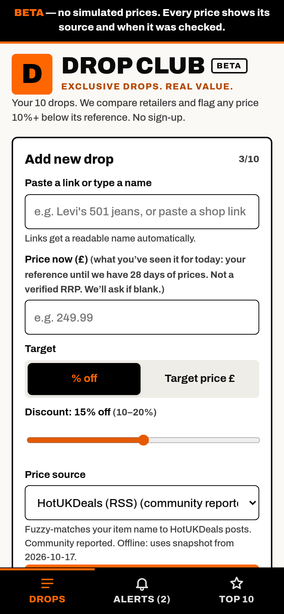
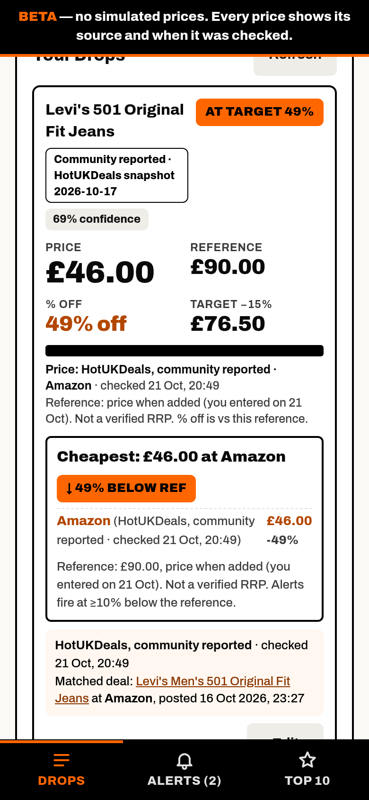
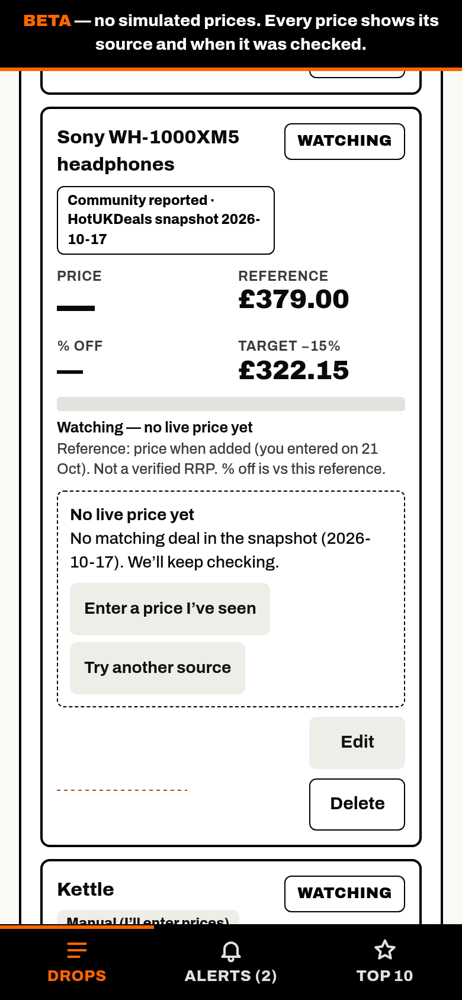
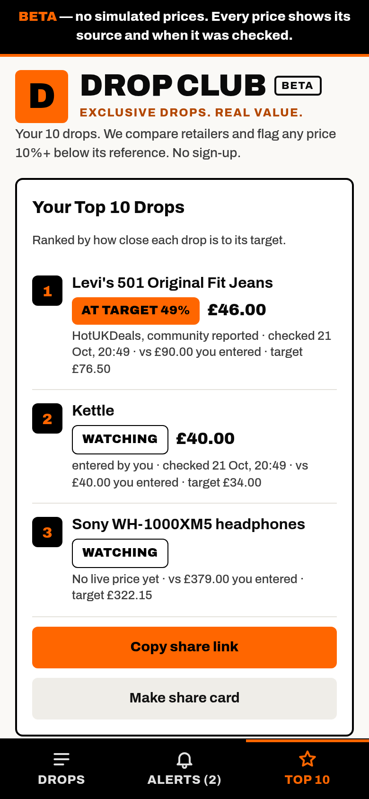
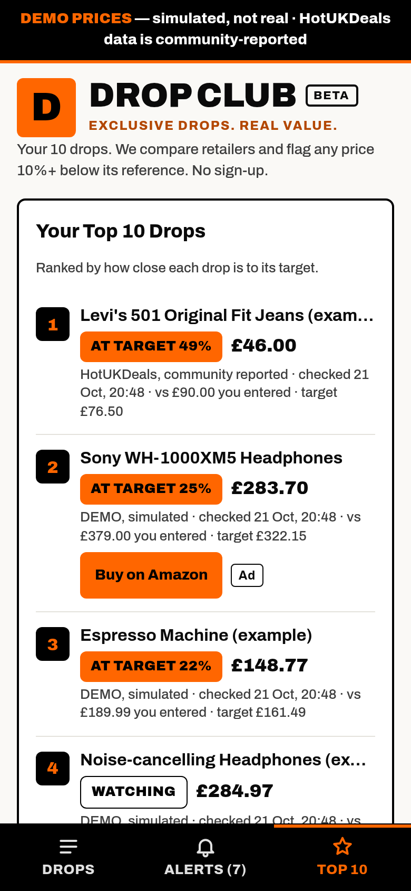
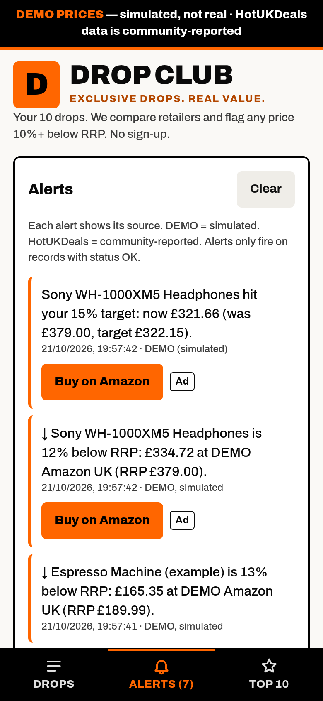
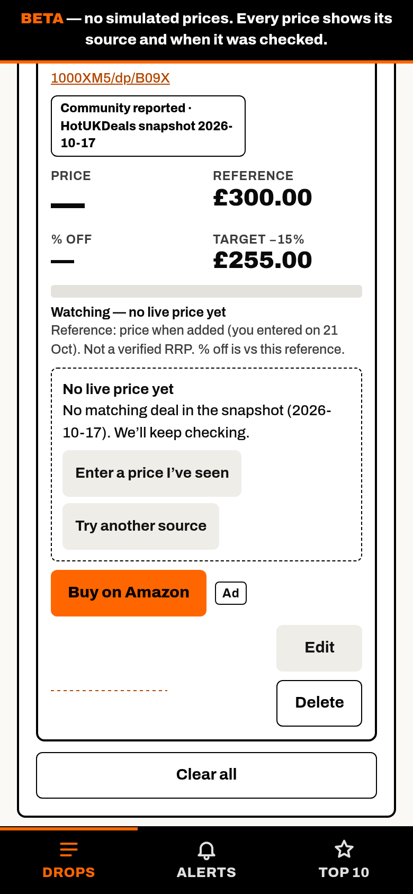
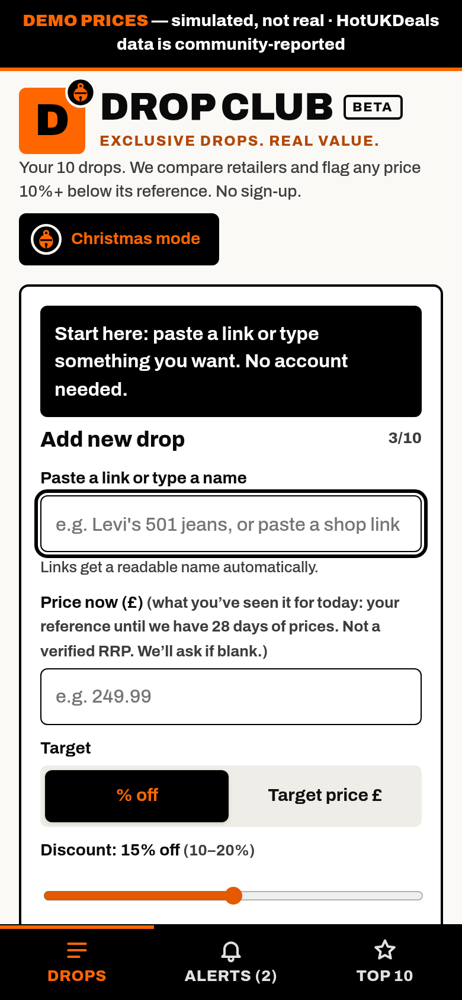
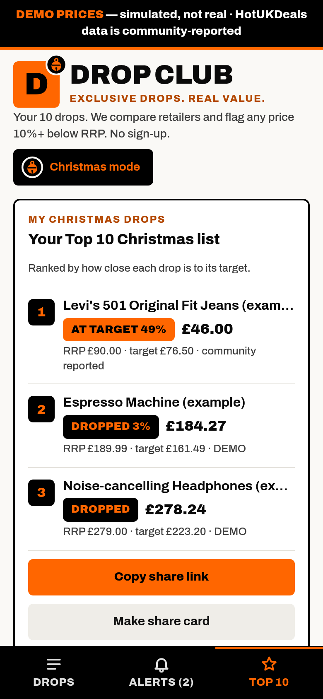
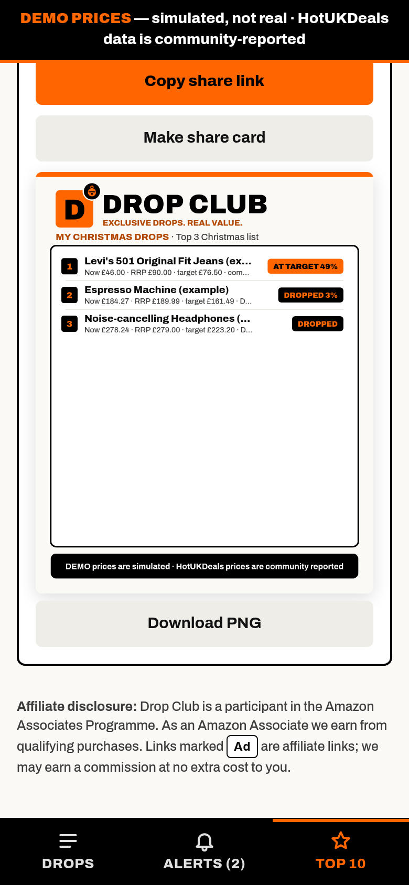

# Drop Club
**EXCLUSIVE DROPS. REAL VALUE.**

**Live:** https://nathanjaldridge-star.github.io/wishlist-drop/

Drop Club tracks up to 10 drops. It checks each one across sources, shows the **cheapest price found**, and alerts you when a price is **10% or more below the lowest we've seen at that retailer in the last 30 days**, or hits your own target. **Beta, no sign-up.**

   

## Public vs demo
- **Public URL** (https://nathanjaldridge-star.github.io/wishlist-drop/): no simulated prices, no DEMO source or offers, no "Simulate a day" or auto-simulate, and no seeded examples. A price only appears when it comes from a real source: HotUKDeals (community reported) or a price you type in (labelled "entered by you"). Items with no real price show **"Watching — no live price yet"**. Every price shown carries a **source badge and a checked-at time**. A **Beta** tag sits next to the wordmark.
- **Demo** (https://nathanjaldridge-star.github.io/wishlist-drop/?demo=1): the old playground with example drops, Simulate a day, auto-simulate and the DEMO Amazon/Argos source. Everything there is labelled DEMO. It uses its own storage key (`dropClub.demo.v2`), so it never mixes with your real list.
- **Old data:** opening the public URL with older DEMO data in `wishlistDrop.v2` removes the example items, drops all simulated prices, offers and alerts, keeps your item names, links and entered prices, and turns auto-simulate off.
- **Invariant, tested:** a visitor never sees an unlabelled fake price. `qa.js` PB1 walks every visible `£` price on Drops, Alerts, Top 10 and the read-only view and fails if it has no source badge, or (for observed prices) no checked-at time. PB3 confirms `?demo=1` still labels everything DEMO.

## Baseline: lowest price seen in 30 days (plan: launch-bf-plan.md §2)
- **Baseline = the lowest price we observed in the prior 30 days at the same retailer.** RRP, retailer "was" prices and the price you typed are never used for drop maths.
- A **drop** is `current ≤ baseline × 0.90`, and a **strong drop** is `≤ 0.80`. With no earlier price there's no drop maths: the card says "No price history yet".
- **Alerts say "Reported deal (community reported)"** until the item has 30 days of history. They're phrased "below the lowest we've seen there since <first-seen date>", never "lowest price". After 30 days they say "Price drop … in the last 30 days". DEMO alerts say DEMO, and your own prices say "entered by you".
- Your entered price only sets **your target** (10–20% below it). It's labelled as your own goal, not a verified RRP.
- **Prices are logged from day one:** in the browser (`item.obs`, every price per retailer) and on the server (append-only `price-log.jsonl` on the `data` branch, written by the mirror).
- **Deal freshness:** a HotUKDeals deal is **stale after 48h**, or **24h in Black Friday week (20 Nov–1 Dec, Europe/London)**, unless it's re-seen in trending. Stale matches give no price, and the card says why.
- **Vouchers and codes are never called "working".** They show as "Reported voucher … Unverified: it may not apply" or "Code posted by the community 2h ago (unverified, may not apply)".
- **Every HotUKDeals item links back to its thread:** deal box, voucher box, alerts, Top 10 and the shared view.

## Themes
Add `?theme=` to the URL. The **Theme** picker appears in the header only when `?theme=` is present or a non-default theme is saved. Your choice is remembered, and the URL wins over the remembered choice.
| Theme | Look | Live |
|---|---|---|
| default | **Drop Club**: black + #FF6600 on off-white, orange D mark, DROP CLUB wordmark, large prices, orange/black pills only | https://nathanjaldridge-star.github.io/wishlist-drop/ |
| purple | The previous purple-clean default | https://nathanjaldridge-star.github.io/wishlist-drop/?theme=purple |
| drop | Bright orange #FF6600 / black / white, Archivo 800–900, tight 6–8px corners, big prices, "DROPPED 18%" badges, black tab bar | https://nathanjaldridge-star.github.io/wishlist-drop/?theme=drop |
| clean | Off-white, near-black text, single green accent #0A7F4F, thin borders, Inter 500/700 | https://nathanjaldridge-star.github.io/wishlist-drop/?theme=clean |
| hybrid | Clean layout, orange only for CTAs, drop badges and "at target" | https://nathanjaldridge-star.github.io/wishlist-drop/?theme=hybrid |

  

Screenshots show the Drop Club default only. The legacy themes are still live via `?theme=`, but their old-branded screenshots have been removed.

The Beta notice (public) or DEMO banner (`?demo=1`) and the source labels show in every theme. All five themes pass an axe-core WCAG AA scan with no colour-contrast failures (`qa/themes-contrast.txt`). White text never sits on #FF6600 (2.9:1). Black is used instead, and small orange text is #B34700. The share card PNG follows the theme. Fonts load from Google Fonts (free) without blocking the page, with system fonts offline.

## Affiliate links & disclosure
**Drop Club is a participant in the Amazon Associates Programme. As an Amazon Associate we earn from qualifying purchases.** Links marked **Ad** are affiliate links, and we may earn a commission at no extra cost to you.

- **Where the tag goes:** `build/src.html`, in the `var AFFILIATE = {...}` block under "Affiliate links". Set `amazonUK: { tag: 'yourtag-21' }`, then run `node build/build.js` to regenerate `index.html`. While the tag is empty, links stay untagged. A console message says "affiliate tag not set", and the footer dev note is visible only with `?debug=1`.
- **Only the Buy button is tagged:** the "Buy on Amazon" button (item cards, alerts, Top 10, shared view) is the only thing tagged. It points to `https://www.amazon.co.uk/dp/ASIN?tag=…`, with tracking parameters stripped, `rel="sponsored noopener"` and a visible "Ad" label.
- **Never tagged:** the item's own link, anything opened automatically, links that already carry someone else's `tag=` (theirs is kept and ours isn't added), and amzn.to / amzn.eu short links (they can't be resolved in the browser).
- **Other retailers:** Skimlinks, Sovrn and Awin deep-link hooks are in `RETAILER_HOOKS`. They're disabled (`enabled:false`) until those programmes approve the site.

## ⚠️ Data labels: please read
- **DEMO prices are simulated, not real, and only exist at `?demo=1`.** Items on the DEMO source (including "DEMO Amazon UK" and "DEMO Argos") follow a random walk. The banner and tags say so everywhere.
- **HotUKDeals data is community reported.** Prices and codes come from user posts on the public HotUKDeals RSS feed and are unverified. Codes are only taken from a post's description text, never generated.
- **Entered by you:** prices you type are labelled as yours, never as a verified RRP.
- The demo's example items are labelled "(example)". The Levi's entered price (£90) is made up.

## Features
- Add an item by pasting a link or typing a name (a link gets a readable name). Price is optional, and you're prompted if it's blank. Set the target as % off or as a £ price.
- Each item card shows a status pill (Watching / Dropped / At target / error), the original price, the current price, % change, the target, a progress bar, a sparkline, the **cheapest offer across sources** and a "⬇ N% below reference" flag.
- Alert feed, newest first, with the source labelled on each alert.
- Top 10: ranked list, a share link encoded in the URL hash (opens a read-only view), and a **share card** PNG (canvas) with download and Web Share.
- Error states from the price contract, each with its own UI: `not_found`, `blocked`, `changed`. There is a DEMO preview for each.

## How sources work
Every source is an adapter: `getPrice(item) → Promise<record>`, plus an optional `getOffers(item) → Promise<record[]>`. Records follow [`docs/price-contract.schema.json`](docs/price-contract.schema.json): whole pence, UTC ISO times, `source`, `confidence`, `error_state`.

| Adapter | Status | Notes |
|---|---|---|
| DEMO | `?demo=1` only | Simulated. Emits `source:"manual"` + `label:"DEMO"` because the schema enum has no `demo` |
| HotUKDeals RSS (`hukd_rss`) | on | Fuzzy title match. `pepper:merchant` gives the retailer, "£2" becomes 200p, the "101° - " prefix is stripped. Labelled community reported |
| Manual | on | Your own price, labelled "entered by you" |
| Awin feed / Awin promotions / Keepa | **awaiting approval** | Disabled stubs that return `blocked` |

**HotUKDeals loading order** (on https): the `data` branch mirror via raw.githubusercontent.com (CORS `*`, about 5 min cache), then `./data/hukd.json` on main (a fallback copy, which goes stale), then the embedded snapshot (2026-10-17). Offline/`file://` uses the snapshot.

## Christmas mode
A seasonal look for the Drop Club default: a black/orange jingle bell on the D mark, "MY CHRISTMAS DROPS" / "Your Top 10 Christmas list" framing, and a Christmas share card. The palette is unchanged and there is no snow.
- Force on: https://nathanjaldridge-star.github.io/wishlist-drop/?season=xmas. Force off: `?season=off`.
- Auto-on 1–31 Dec (Europe/London date) via `AUTO_XMAS=true` in the head script. It never triggers outside December.
- The "Christmas mode" toggle appears only when the season is active, the param is present, or it's December. The choice is remembered in `localStorage["dropClub.season"]`.

  

## Repo layout
- `index.html`: the whole app (self-contained, also works offline from `file://`), built from `build/src.html` with `build/hukd_sample.xml` injected at `%%HUKD%%`.
- `build/test.js`: headless test (playwright-core + system Chrome, ajv schema validation). Run `npm i playwright-core ajv ajv-formats && node build/test.js` (it uses absolute paths from the dev box; adjust `D`).
- `scripts/fetch-hukd.mjs` + `scripts/hukd-config.json`: the mirror. It fetches **only public HUKD RSS**: `/rss/new`, `/rss/hot` (trending), `/rss/vouchers` and `/rss/tag/{lego,headphones,apple,gaming}`. It never fetches retailer pages, so there's no server-side scraping.
  - **Merchant filter:** keeps only deals whose `pepper:merchant` is one of Amazon, Argos, Currys, John Lewis, Boots, AO, Very, eBay, Screwfix, Halfords, Uniqlo or Overclockers.
  - **What's stored:** title, thread link, merchant, price/discount, pubDate, temperature and code strings only. No description HTML.
  - **Dedupe:** by `guid`, plus cross-posts (merchant + title + price within 48h, keeping the hottest thread).
  - **Retention:** deals are kept for 7 days.
  - **Per-feed cadence:** new 5 min (2 min in BF week), trending 15 min, vouchers and tags 30 min.
  - **Robustness:** conditional GET (HUKD currently sends no ETag or Last-Modified), 15s timeout, one retry on 5xx/429, validation, keep-previous on failure, atomic writes, and an overflow warning when every `/rss/new` item is unseen.
  - **Price log:** appends `price-log.jsonl`.
  - **Tests:** `scripts/test-fetch-hukd.mjs` (18 offline checks).
- `docs/workflows/hukd-mirror.yml`: **ready to move** to `.github/workflows/` (needs the `workflow` token scope or the web UI).
  - Runs every 5 min (`*/5`, GitHub's minimum; runs can be late or skipped), self-tests, fetches due feeds and commits to the **`data` branch**.
  - Kept off main so Pages isn't rebuilt every 5 min (soft limit about 10/hour).
  - **2-minute polling in BF week isn't possible on GitHub.** The proposal is Cloudflare Workers Cron (`docs/cloudflare-worker-cron.md`). It's a free sign-up, so it needs Nathan's approval.
- `data/hukd.json`: fallback copy of the mirror (v2). The live mirror and the append-only price log are on the `data` branch. `docs/`: the price contract. `themes/`: current Drop Club screenshots.

## Limitations
- In-browser alerts only, and only while the page is open. There's no email or push yet (see roadmap).
- No real retailer prices yet. HotUKDeals only covers items someone has posted. Fuzzy matching can mis-match (confidence is shown).
- History is per browser plus the server price log. The app doesn't read the server log yet; the next step is to compute a shared 30-day low per merchant and title from it. Until we have 30 days, alerts are labelled "Reported deal".
- The share link carries a snapshot of the prices at the moment you copied it.

## Roadmap: a real site on free tiers (no paid sign-ups)
1. **Hosting:** GitHub Pages (now), or Cloudflare Pages plus Workers for the API.
2. **Accounts and storage:** Supabase free tier (Postgres + magic-link auth + RLS), or Cloudflare D1.
3. **Scheduled checks:** GitHub Actions cron (now, for the HUKD mirror), then Workers cron. Check each unique product once, write daily `price_history`, compute the cheapest offer and the gap against the reference (later a 30–90 day median), and create an alert on a new ≥10% drop.
4. **Email alerts:** Resend (3k/month free) or Brevo (300/day free). Double opt-in, digest, unsubscribe link, dedupe log.
5. **Real prices:** Awin publisher (free to apply; per-advertiser approval for Currys/Argos/John Lewis…), Amazon Associates / PA-API (needs qualifying sales), Keepa (paid, later). No scraping of retailer sites.
6. **Compliance:** UK GDPR privacy notice, affiliate disclosure, keep source labels.
