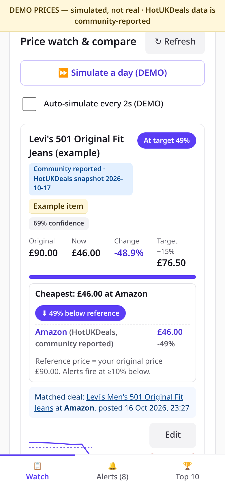
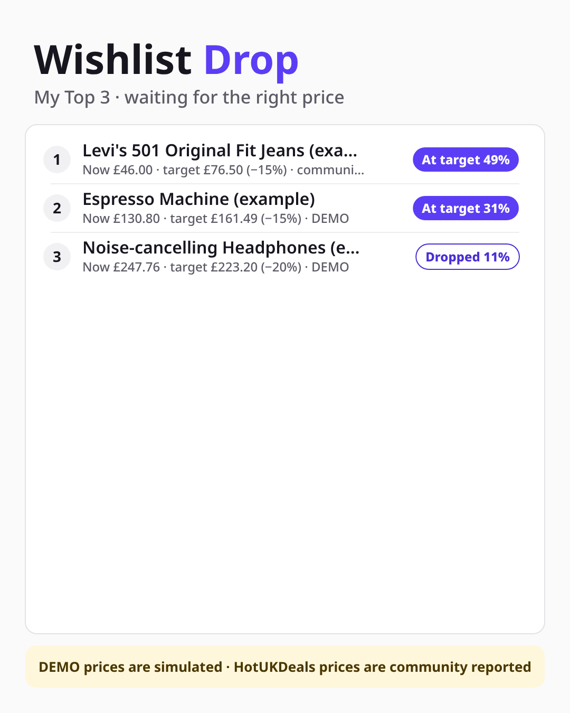
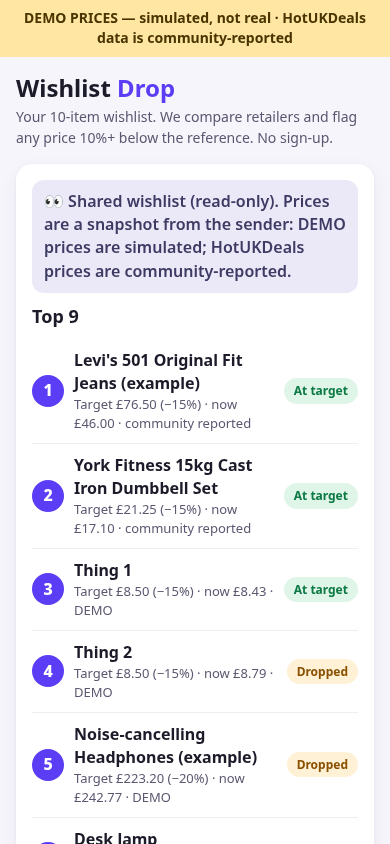
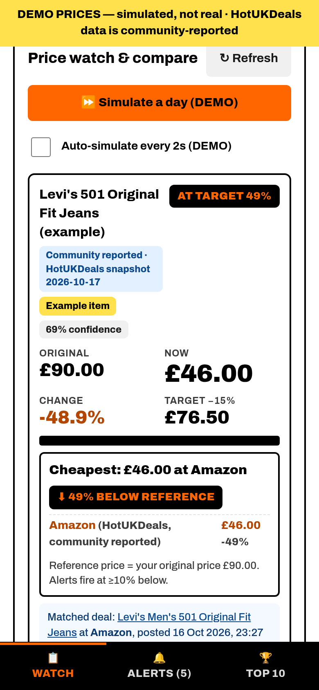
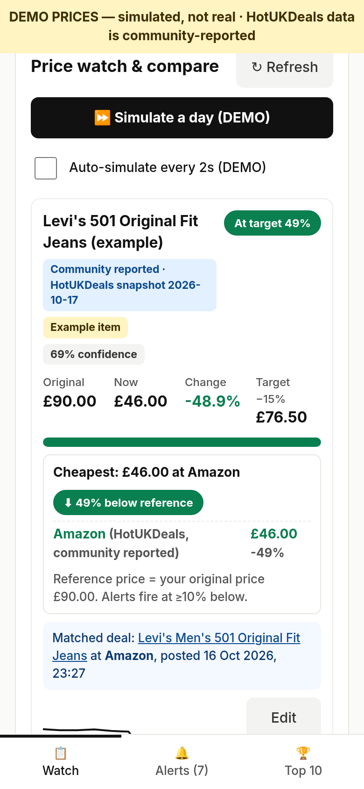
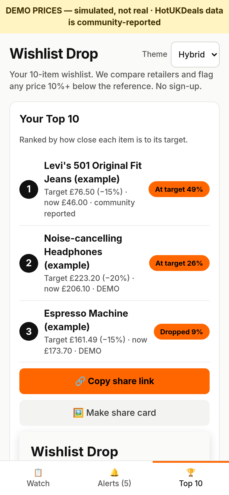
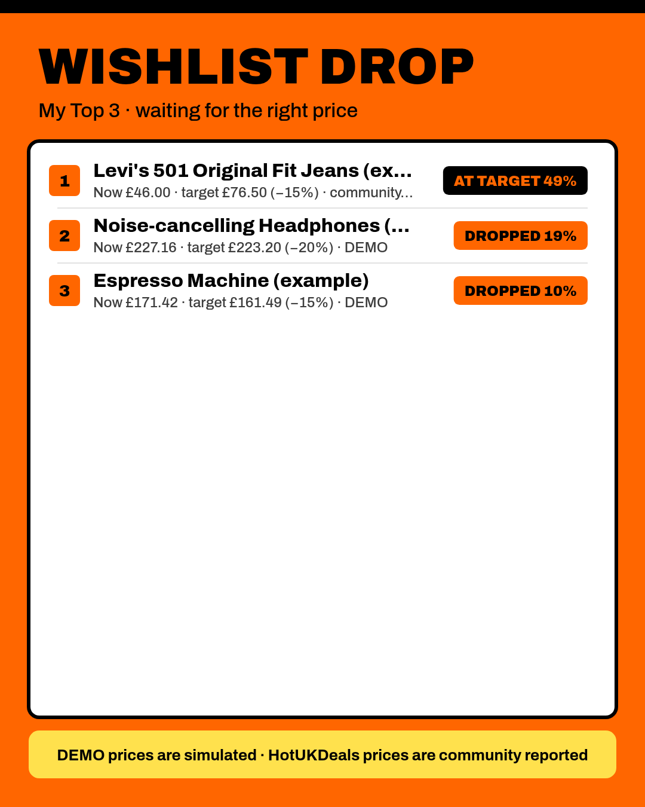

# Wishlist Drop

**Live:** https://nathanjaldridge-star.github.io/wishlist-drop/

Make a 10-item wishlist. Wishlist Drop checks each item across retailers and sources, shows the **cheapest retailer and how far below your reference price it is**, and alerts you when an item is **10% or more below** the reference, or hits your own target (10–20%, default 15%). No sign-up: everything is saved in your browser.

  

## Themes
Add `?theme=` to the URL. The **Theme** picker appears in the header only when `?theme=` is present or a non-default theme is saved. Your choice is remembered, and the URL wins over the remembered choice.
| Theme | Look | Live |
|---|---|---|
| default | Purple-clean: off-white, thin borders, purple as the only accent, "Wishlist **Drop**" wordmark (no theme picker on the plain URL) | https://nathanjaldridge-star.github.io/wishlist-drop/ |
| drop | Bright orange #FF6600 / black / white, Archivo 800–900, tight 6–8px corners, big prices, "DROPPED 18%" badges, black tab bar | https://nathanjaldridge-star.github.io/wishlist-drop/?theme=drop |
| clean | Off-white, near-black text, single green accent #0A7F4F, thin borders, Inter 500/700 | https://nathanjaldridge-star.github.io/wishlist-drop/?theme=clean |
| hybrid | Clean layout, orange only for CTAs, drop badges and "at target" | https://nathanjaldridge-star.github.io/wishlist-drop/?theme=hybrid |

    

The DEMO banner and labels show in every theme. All four themes pass an axe-core WCAG AA scan with no colour-contrast failures (`qa/themes-contrast.txt`). White text never sits on #FF6600 (2.9:1). Black is used instead, and small orange text is #B34700. The share card PNG follows the theme. Fonts load from Google Fonts (free) without blocking the page, with system fonts offline.

## ⚠️ Data labels: please read
- **DEMO prices are simulated, not real.** Items on the DEMO source (including "DEMO Amazon UK" and "DEMO Argos") follow a random walk. The banner and tags say so everywhere.
- **HotUKDeals data is community reported.** Prices and codes come from user posts on the public HotUKDeals RSS feed and are unverified. Codes are only taken from a post's description text, never generated.
- The example items are labelled "(example)". The Levi's reference price (£90) is made up.

## Features
- Add an item by pasting a link or typing a name (a link gets a readable name). Price is optional, and you're prompted if it's blank. Set the target as % off or as a £ price.
- Each item card shows a status pill (Watching / Dropped / At target / error), the original price, the current price, % change, the target, a progress bar, a sparkline, the **cheapest offer across sources** and a "⬇ N% below reference" flag.
- Alert feed, newest first, with the source labelled on each alert.
- Top 10: ranked list, a share link encoded in the URL hash (opens a read-only view), and a **share card** PNG (canvas) with download and Web Share.
- Error states from the price contract, each with its own UI: `not_found`, `blocked`, `changed`. There is a DEMO preview for each.

## How sources work
Every source is an adapter: `getPrice(item) → Promise<record>`, plus an optional `getOffers(item) → Promise<record[]>`. Records follow [`docs/price-contract.schema.json`](docs/price-contract.schema.json): whole pence, UTC ISO times, `source`, `confidence`, `error_state`.

| Adapter | Status | Notes |
|---|---|---|
| DEMO | on | Simulated. Emits `source:"manual"` + `label:"DEMO"` because the schema enum has no `demo` |
| HotUKDeals RSS (`hukd_rss`) | on | Fuzzy title match. `pepper:merchant` gives the retailer, "£2" becomes 200p, the "101° - " prefix is stripped. Labelled community reported |
| Manual | on | Your own price |
| Awin feed / Awin promotions / Keepa | **awaiting approval** | Disabled stubs that return `blocked` |

**HotUKDeals loading order:** on https, `./data/hukd.json` (a same-origin mirror, so no CORS), then the live feed (usually CORS-blocked), then the embedded snapshot (2026-10-17). The mirror is refreshed every 30 minutes by [`docs/workflows/hukd-mirror.yml`](docs/workflows/hukd-mirror.yml) (**pending: move it to `.github/workflows/` to activate**; the deploy token lacked the `workflow` scope), which runs [`scripts/fetch-hukd.mjs`](scripts/fetch-hukd.mjs).

## Repo layout
- `index.html`: the whole app (self-contained, also works offline from `file://`), built from `build/src.html` with `build/hukd_sample.xml` injected at `%%HUKD%%`.
- `build/test.js`: headless test (playwright-core + system Chrome, ajv schema validation). Run `npm i playwright-core ajv ajv-formats && node build/test.js` (it uses absolute paths from the dev box; adjust `D`).
- `data/hukd.json`: the RSS mirror. `docs/`: the price contract. `screenshots/`.

## Limitations
- In-browser alerts only, and only while the page is open. There's no email or push yet (see roadmap).
- No real retailer prices yet. HotUKDeals only covers items someone has posted. Fuzzy matching can mis-match (confidence is shown).
- The reference price is your entered original price, not a historical median.
- The share link carries a snapshot of the prices at the moment you copied it.

## Roadmap: a real site on free tiers (no paid sign-ups)
1. **Hosting:** GitHub Pages (now), or Cloudflare Pages plus Workers for the API.
2. **Accounts and storage:** Supabase free tier (Postgres + magic-link auth + RLS), or Cloudflare D1.
3. **Scheduled checks:** GitHub Actions cron (now, for the HUKD mirror), then Workers cron. Check each unique product once, write daily `price_history`, compute the cheapest offer and the gap against the reference (later a 30–90 day median), and create an alert on a new ≥10% drop.
4. **Email alerts:** Resend (3k/month free) or Brevo (300/day free). Double opt-in, digest, unsubscribe link, dedupe log.
5. **Real prices:** Awin publisher (free to apply; per-advertiser approval for Currys/Argos/John Lewis…), Amazon Associates / PA-API (needs qualifying sales), Keepa (paid, later). No scraping of retailer sites.
6. **Compliance:** UK GDPR privacy notice, affiliate disclosure, keep source labels.
